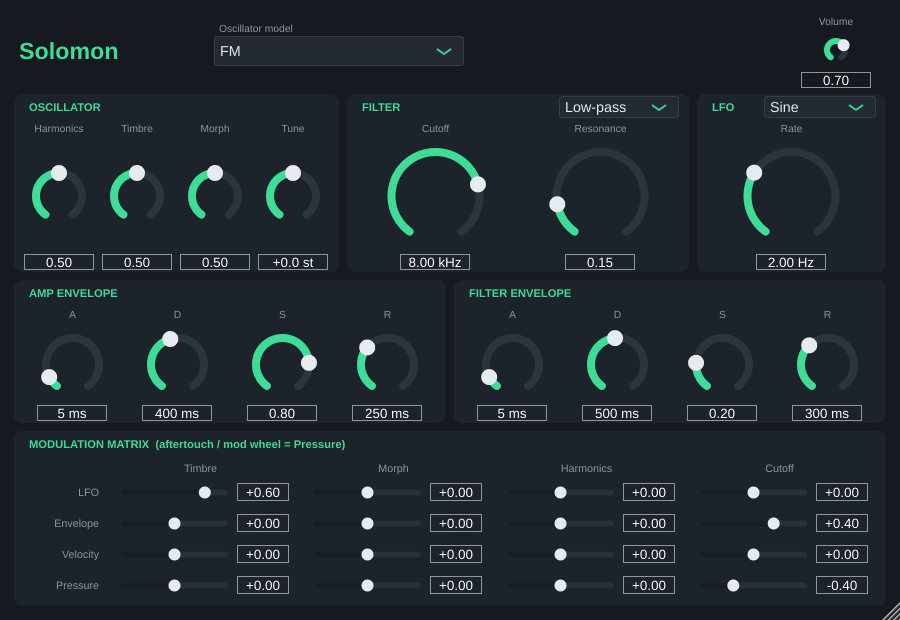

# Solomon

[](https://github.com/ravaninip/Solomon/actions/workflows/build.yml)
[](LICENSE)


**Solomon is a hybrid digital synthesizer with a modulation matrix, available as a VST® 3 and Audio Unit plug-in.**
It combines 17 oscillator models (virtual analog, phase distortion, FM, wavetable, granular, additive, strings, chords and more) with a multi-mode filter, two envelopes, an LFO and a 4 × 4 modulation matrix, in a four-voice paraphonic design.

Everything runs offline: no network access, no telemetry, no accounts.

<p align="center">
  
</p>

## Table Of Contents

1. [The Solomon package](#the-solomon-package)
1. [System requirements](#system-requirements)
1. [Features](#features)
1. [Installation](#installation)
1. [How to build Solomon](#how-to-build-solomon)
1. [Known limitations](#known-limitations)
1. [Roadmap](#roadmap)
1. [Contributing](#contributing)
1. [Security](#security)
1. [License & Usage guidelines](#license--usage-guidelines)

## The Solomon package

```
Source/Engine/     synth engine in pure C++ (no JUCE): oscillator wrapper, resampler, filter, envelopes, LFO, voices
Source/            JUCE plug-in (parameters, MIDI, state, editor)
third_party/       vendored oscillator code (MIT), with its own README and license notices
Tests/             engine tests and host-less plug-in smoke test
tools/             maintenance scripts (re-importing the vendored code)
docs/              additional documentation
```

## System requirements

| Operating system | Architecture | Formats | Compiler (to build) | Notes |
| :--- | :--- | :--- | :--- | :--- |
| Windows 10 / 11 | x86_64 | VST 3 | MSVC 2022 | Prebuilt in Releases |
| macOS 11 or later | x86_64, Apple Silicon (universal) | VST 3, AU | Xcode 14 or later | Prebuilt in Releases |
| Linux (Ubuntu 24.04) | x86_64 | VST 3 | GCC 13 or later | Build from source |

## Features

- **17 oscillator models** with three macro controls (*Harmonics*, *Timbre*, *Morph*) whose meaning
  depends on the model: Analog + Filter, Phase Distortion, Wave Terrain, String Machine, Chiptune,
  Virtual Analog, Waveshaper, FM, Granular, Additive, Wavetable, Chords, Swarm, Noise, Particles,
  Plucked String and Modal Resonator.
- **Paraphonic, 4 voices:** each voice has its own oscillator and amplitude envelope; filter, filter
  envelope and LFO are shared. Oldest-note voice stealing, sustain pedal.
- **Multi-mode filter** (low-, band-, high-pass) with resonance that stays stable under fast modulation.
- **Two ADSR envelopes** (amplitude and filter) and a **tempo-free LFO** (sine, triangle, saw, square,
  sample & hold).
- **4 × 4 modulation matrix:** LFO, filter envelope, velocity and pressure (aftertouch or mod wheel)
  to Timbre, Morph, Harmonics and Cutoff.
- **MIDI:** sample-accurate notes, velocity, pitch bend (±2 semitones), mod wheel, channel and
  polyphonic aftertouch, sustain pedal, all-notes-off.
- All controls are **automatable** parameters and are saved with the project.
- **Any sample rate:** the engine runs at 48 kHz internally and is converted to the host rate with a
  band-limited resampler (verified at 22.05 to 192 kHz).
- **Resizable interface** with tooltips.

## Installation

1. Download the latest zip for your platform from [**Releases**](https://github.com/ravaninip/Solomon/releases).
2. Copy the plug-in bundle to your plug-in folder:
   - **Windows:** `Solomon.vst3` → `C:\Program Files\Common Files\VST3`
   - **macOS:** `Solomon.vst3` → `~/Library/Audio/Plug-Ins/VST3`, or `Solomon.component` → `~/Library/Audio/Plug-Ins/Components`
3. Rescan plug-ins in your host.

> [!WARNING]
> The binaries are not code-signed yet. On Windows, SmartScreen may ask for confirmation
> (*More info → Run anyway*). On macOS, remove the quarantine flag if the plug-in is blocked:
> `xattr -dr com.apple.quarantine ~/Library/Audio/Plug-Ins/VST3/Solomon.vst3`

## How to build Solomon

JUCE (which bundles the VST 3 SDK) is fetched automatically at configure time.

### Windows

```powershell
cmake -B build -G "Visual Studio 17 2022" -A x64
cmake --build build --config Release --parallel
ctest --test-dir build -C Release --output-on-failure
```

Or run `powershell -ExecutionPolicy Bypass -File .\build-windows.ps1` (builds, tests and installs).

### macOS

```bash
cmake -B build -G Xcode -DCMAKE_OSX_ARCHITECTURES="arm64;x86_64"
cmake --build build --config Release --parallel
ctest --test-dir build -C Release --output-on-failure
```

### Linux

Install `libx11-dev libxrandr-dev libxinerama-dev libxcursor-dev libxext-dev libfreetype-dev libfontconfig1-dev libasound2-dev`, then:

```bash
cmake -B build -DCMAKE_BUILD_TYPE=Release
cmake --build build --parallel
ctest --test-dir build --output-on-failure
```

### Build options

| CMake option | Default | Description |
|---|---|---|
| `SOLOMON_BUILD_PLUGIN` | `ON` | Build the JUCE plug-in. Turn off to build and test only the engine. |
| `SOLOMON_BUILD_TESTS` | `ON` | Build the engine tests. |
| `SOLOMON_BUILD_PLUGIN_TESTS` | `OFF` | Host-less smoke test; `./build/solomon_plugin_smoke shot.png` saves a UI screenshot. |
| `SOLOMON_COPY_AFTER_BUILD` | `OFF` | Copy the plug-in into the user's plug-in folder after building. |
| `SOLOMON_JUCE_PATH` | *(empty)* | Use a local JUCE checkout instead of downloading it. |
| `SOLOMON_JUCE_TAG` | `8.0.15` | JUCE tag to download. |

## Known limitations

- Version 0.x: the sound design and presets are still being developed; there is no preset browser yet.
- The six-operator FM models, the speech model and the drum models of the original oscillator
  code are intentionally not included.
- Voice stealing retriggers the pitch abruptly (no glide), so very dense chords played while all voices are
  busy can click.
- The plug-in has been tested host-less and with the VST 3 validator; please report anything that
  behaves differently in your DAW.

## Roadmap

- Preset browser and a first factory bank
- Glide, unison and a cycling envelope
- Arpeggiator and sequencer
- Effects (delay, reverb)
- Code-signed and notarised installers for Windows and macOS

## Contributing

Bug reports, feature ideas and pull requests are welcome. Please read [CONTRIBUTING.md](CONTRIBUTING.md) and the
[Code of Conduct](CODE_OF_CONDUCT.md) first.

## Security

Solomon makes no network connections and collects no data. To report a vulnerability, see [SECURITY.md](SECURITY.md).

## License & Usage guidelines

- **Solomon** is free software under the [GNU Affero General Public License v3.0](LICENSE).
- It is built with [JUCE](https://juce.com) 8, used under the AGPLv3, which bundles the
  [VST 3 SDK](https://github.com/steinbergmedia/vst3sdk) (MIT license).
- The oscillator models are derived from the MIT-licensed open-source code of the Plaits module by
  Emilie Gillet (Mutable Instruments), see [third_party/mutable](third_party/mutable/README.md).
- Third-party components and their licenses are listed in [THIRD_PARTY_NOTICES.md](THIRD_PARTY_NOTICES.md).

### Trademarks

VST is a registered trademark of Steinberg Media Technologies GmbH.
The VST Compatible Logo is used unaltered, in accordance with the
[Steinberg VST Usage Guidelines](https://github.com/steinbergmedia/vst3sdk/blob/master/VST3_Usage_Guidelines.pdf).
Audio Units is a trademark of Apple Inc. Mutable Instruments and Plaits are names of their respective
owner. Solomon is an independent project and is not affiliated with or endorsed by Steinberg, Apple or
Mutable Instruments.
